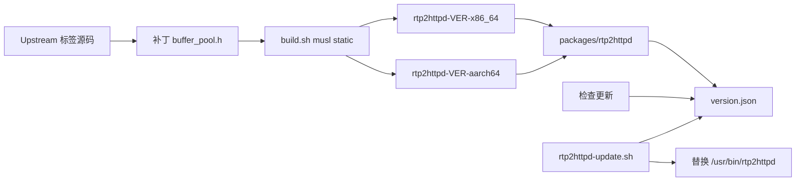

# rtp2httpd 自编译 OTA

Feature Name: rtp2httpd-custom-ota
Updated: 2026-10-11

## Description

从 Upstream 标签拉取源码，把 `BUFFER_POOL_INITIAL_SIZE` 与 `BUFFER_POOL_EXPAND_SIZE` 改为 1024，用 musl 静态工具链编出 x86_64 与 aarch64 二进制，放到本仓库 `packages/rtp2httpd/`。路由器 LuCI 检查/更新只读该目录的 `version.json`。

## Architecture

现有 GitHub Release API 路径改为本仓库 Manifest。`update_mirror` 仍可加在 raw GitHub URL 前面。

## Components and Interfaces

- `packaging/rtp2httpd/buffer-pool-1024.patch`: 改 INITIAL/EXPAND 为 1024
- `packaging/rtp2httpd/build.sh`: 参数为 Upstream 版本号；下载源码、打补丁、编两架构、写 Manifest
- `packages/rtp2httpd/version.json`: version、date、changelog、url、url_aarch64
- `rtp2httpd-ota-check.sh`: curl Manifest，缓存 latest
- `rtp2httpd-update.sh`: 按 DISTRIB_ARCH 选 url 或 url_aarch64，下载后原子替换
- LuCI `rtp2httpd_check`: 读同一 Manifest

二进制命名与官方一致：`rtp2httpd-<version>-x86_64` / `rtp2httpd-<version>-aarch64`。

## Data Models

`packages/rtp2httpd/version.json`:

- `version`: Upstream 标签去掉 v，例如 3.17.2
- `date`: 构建日期 YYYY-MM-DD
- `changelog`: 补丁说明
- `url`: x86_64 二进制的 raw GitHub 地址
- `url_aarch64`: aarch64 二进制的 raw GitHub 地址

`/tmp/rtp2httpd-version.json` 缓存：`{"latest":"3.17.2"}`。

## Correctness Properties

- 新文件 `--help` 解析不到版本号时，不替换现有二进制
- 下载失败时保留 `/usr/bin/rtp2httpd`
- 仓库同一目录只保留当前版本的两份二进制

## Error Handling

- Manifest 不可达：检查更新返回错误，不改本地二进制
- 架构无法匹配：按 x86_64 的 url 回退前，aarch64* 必须用 url_aarch64
- 替换后 7 秒内无进程：状态 failed，提示手动 `/etc/init.d/iptv-auth restart`

## Test Strategy

- 本机构建后 `file` 确认两份均为静态 musl
- 在 x86_64 路由上下载、`--help` 见 3.x.y、替换后 pid 存在
- LuCI 检查更新显示 Manifest 版本，不再请求 stackia releases/latest

## References

[^1]: (Website) - [rtp2httpd buffer_pool.h](https://github.com/stackia/rtp2httpd/blob/v3.17.2/src/buffer_pool.h)
[^2]: (Filename) - `src/router-files/usr/bin/rtp2httpd-update.sh`
[^3]: (Filename) - `.monkeycode/specs/2026-10-11-rtp2httpd-custom-ota/requirements.md`
