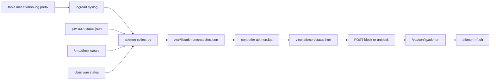

# 安全监测

Feature Name: wan-attack-monitor
Updated: 2026-10-12

## Description

新增 `luci-app-atkmon`。采集进程解析 syslog 与现有状态文件，覆盖外网爆破/探测、PPPoE、DNS、IPTV 代理、DHCP。LuCI 一级菜单「安全监测」用 SVG 图表展示。管理员可手动拉黑外网来源（仅 WAN INPUT）。

## Architecture

图表沿用状态监控的 SVG，不引入 echarts。dnsmasq `logqueries` 由 uci-defaults 打开，采集只保留聚合与最近事件。

## Components and Interfaces

- `luci.controller.atkmon`：一级菜单 `admin/atkmon` 标题「安全监测」，order=4
- JSON：`data`、`events`、`block`、`unblock`
- `/usr/bin/atkmon-collect.py`：每 5 秒读 logread 增量、ubus wan、leases、iptv status，写 snapshot
- `/usr/bin/atkmon-nft.sh`：独立 `inet atkmon` 表，WAN NEW 限速日志，block4/block6 reject
- `/etc/init.d/atkmon`：procd 采集；启动时执行 nft 脚本
- `/etc/config/atkmon`：enabled、wan_if、block 列表、open_ports、dns_log
- `view/atkmon/status.htm`：总览卡 + 攻击/PPPoE/DNS/IPTV/DHCP 分区

拉黑只 hook INPUT priority -10，LAN 转发不动。

## Data Models

`/var/lib/atkmon/snapshot.json`：

- `cards`：攻击/重拨/NXDOMAIN/新终端/IPTV 会话的 24h 计数
- `series`：小时桶 168 点，字段 auth/probe/pppoe/dns_nx/dhcp/iptv
- `attack_summary`：按 IP 聚合
- `pppoe`：up、uptime、ipv4、ipv6、redials_24h、events
- `dns`：queries、nxdomain、top、nx_top、hot_clients、available
- `iptv`：auth_ok、live、catchup、events
- `dhcp`：leases、new_24h、events
- `blocked`：当前拉黑地址
- `probe_available`：nft 日志是否出现过

原始事件保留在 `/var/lib/atkmon/events.jsonl`，24 小时或 20000 条上限。

## Correctness Properties

- RFC1918、ULA、链路本地、回环、br-lan 前缀不计入外网攻击，也不可拉黑
- 开放端口列表内的 WAN NEW 不记为探测
- 拉黑只拒绝访问本机
- 同一 syslog 行只入账一次
- 10 分钟认证失败 5 次标爆破；5 分钟 8 个不同端口标扫描；24 小时 PPPoE 重拨 5 次标频繁重拨；1 分钟 200 次 DNS 查询标高频

## Error Handling

- 单行解析失败：跳过
- iptv-auth 未安装：IPTV 区显示未运行
- DNS 查询日志关闭：DNS 区提示不可用
- 拉黑非法地址：HTTP 400

## Test Strategy

- 伪造 dropbear/luci/atkmon/pppd/dnsmasq/DHCP 日志行，核对 snapshot
- LAN 地址不出现在 attack_summary
- block 后 nft set 含该 IP，unblock 后消失
- LuCI 24h/7d 切换后面板同步

## References

[^1]: (Filename) - `.monkeycode/specs/2026-10-12-wan-attack-monitor/requirements.md`
[^2]: (Filename) - `src/router-files/usr/lib/lua/luci/view/statusmon/status.htm`
[^3]: (Filename) - `src/router-files/usr/bin/iptv-auth.py`
